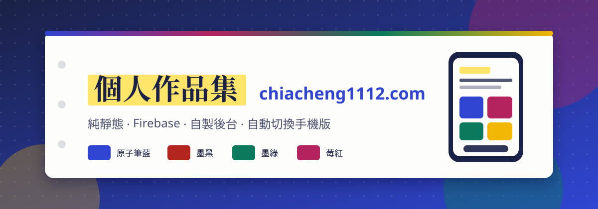
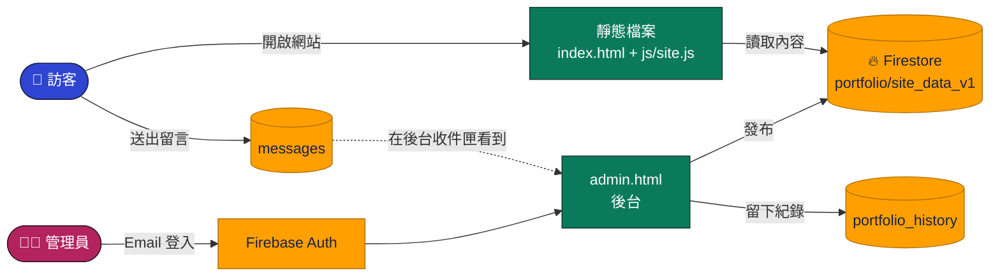
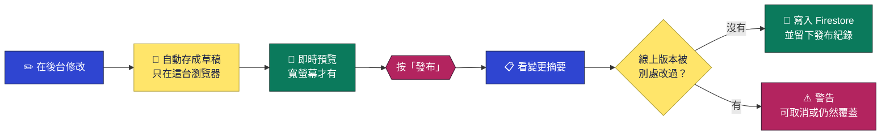
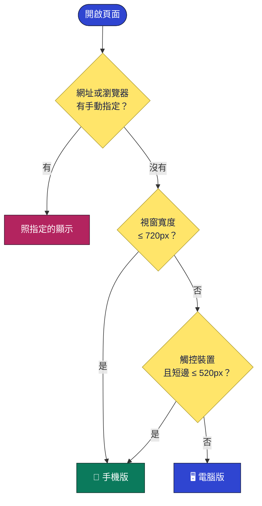

<div align="center">



<br>

[](https://chiacheng1112.com/)
[](https://chiacheng1112.com/?view=mobile)
[](https://github.com/Jiachang1112)


**純靜態作品集 ‧ 內容存在 Firebase ‧ 自己做的管理後台 ‧ 手機與電腦自動切換**

<br>

[](#-快速開始)
[](#-firebase-設定從零開始)
[](#-後台使用教學)
[](#-手機版與自動偵測)
[](#-部署)
[](#-讓-google-找到你的網站)
[](#-常見問題)

</div>

---

## ✨ 特色

<table>
<tr>
<td width="33%" valign="top">

### 🖋️ 手記風格
白紙、藍黑墨水、原子筆藍、螢光筆黃。只保留往下捲動時的淡入動畫，其餘不做花俏效果。

</td>
<td width="33%" valign="top">

### 🛠️ 自製後台
9 個管理頁面：改資料、管專案、寫日誌、收留言、換配色、備份還原，全部在瀏覽器裡完成。

</td>
<td width="33%" valign="top">

### 📱 專屬手機版
不是把電腦版縮小。底部導覽列、底部彈窗、橫向滑動卡片，並且自動偵測裝置。

</td>
</tr>
<tr>
<td valign="top">

### 📝 草稿與發布
所有修改先存成草稿，按「發布」才上線。發布前有變更摘要，也會擋掉會覆蓋別人修改的情況。

</td>
<td valign="top">

### 🎨 四套配色
原子筆藍、墨黑、墨綠、莓紅，也能自訂三個顏色，並附對比檢查，避免字太淡看不清楚。

</td>
<td valign="top">

### 🔒 安全規則
Firestore 規則只讓你指定的信箱寫入，訪客只能讀取內容、送出格式正確的留言。

</td>
</tr>
</table>

---

## 🧩 運作方式



- 網站是**純靜態檔案**，不需要 `npm install`，也不需要 build，丟到任何靜態主機就能跑。
- 內容整份存在 Firestore 的**一份文件**裡（`portfolio/site_data_v1`）。Firebase 連不上時，前台會用內建的預設內容顯示，不會整頁空白。
- 後台是同一個專案裡的 `admin.html`，用 Firebase Authentication 的 Email／密碼登入。

### 📁 檔案說明

```text
chiacheng/
├── index.html              前台入口（內容由 js/site.js 畫出來）
├── admin.html              後台入口（已設 noindex，搜尋引擎不會收錄）
├── 404.html                找不到頁面
├── firestore.rules         Firestore 安全規則（要貼到 Firebase 主控台）
├── robots.txt              搜尋引擎規則
├── sitemap.xml             網站地圖
├── CNAME                   自訂網域
├── assets/                 分享預覽圖、favicon、README 橫幅
├── css/
│   ├── site.css            前台樣式（含手機版）
│   └── admin.css           後台樣式（含手機版）
└── js/
    ├── device.js           裝置偵測，前台與後台共用
    ├── data.js             預設內容、資料整理 normalize()、共用工具
    ├── store.js            Firebase 連線與前台讀取（SDK 動態載入）
    ├── site.js             前台：各區塊、作品篩選、聯絡表單、捲動淡入
    └── admin/
        ├── main.js         登入、外框、路由、發布流程、即時預覽
        ├── core.js         草稿、發布、檢查、變更摘要
        ├── cloud.js        後台用的 Firebase 操作與錯誤訊息
        ├── ui.js           對話框、提示、標籤輸入等小元件
        └── views/          總覽、基本資料、專案、技術、日誌、連結、外觀、訊息、備份
```

---

## ⚡ 快速開始

> 只想在自己電腦上看看？不用 Firebase 也能跑，會顯示內建的預設內容。

**1. 下載專案**

```bash
git clone https://github.com/Jiachang1112/chiacheng.git
cd chiacheng
```

**2. 啟動本機伺服器**（任何靜態伺服器都可以）

```bash
python3 -m http.server 8000
# 或：npx serve .
```

**3. 打開瀏覽器**

| 想看什麼 | 網址 |
| --- | --- |
| 🌐 前台（自動偵測裝置） | http://localhost:8000/ |
| 📱 強制看手機版 | http://localhost:8000/?view=mobile |
| 🖥️ 強制看電腦版 | http://localhost:8000/?view=desktop |
| 🛠️ 後台 | http://localhost:8000/admin.html |

> ⚠️ 不能直接雙擊 `index.html` 開啟。檔案用 ES Modules，瀏覽器要求透過 `http://` 載入。

想要連到**你自己的** Firebase 並使用後台，請繼續往下看。

---

## 🔥 Firebase 設定（從零開始）

這個專案預設連到作者自己的 Firebase 專案。如果你是 fork 或複製來用，**請換成你自己的專案**，否則你登入不了後台，也寫不進資料。

<details open>
<summary><b>① 建立 Firebase 專案</b></summary>

1. 打開 [Firebase 主控台](https://console.firebase.google.com/)，按「新增專案」，名稱隨意。
2. Google Analytics 可以關掉，不影響功能。

</details>

<details open>
<summary><b>② 建立 Firestore 資料庫</b></summary>

1. 左側選單 → **Firestore Database** → 「建立資料庫」。
2. 選離你近的區域（台灣用戶可選 `asia-east1`）。
3. 模式選「正式版模式」就好，規則下一步再貼。

</details>

<details open>
<summary><b>③ 開啟 Email／密碼登入，並建立管理員帳號</b></summary>

1. 左側選單 → **Authentication** → 「開始使用」→ 登入方式選 **電子郵件／密碼**，啟用。
2. 切到 **Users** 分頁 → 「新增使用者」，輸入 Email 與密碼。**每位管理員各建立一個**，這些就是後台的登入帳號。
3. 切到 **Settings → 已授權網域**，加入你的正式網域（例如 `chiacheng1112.com`）。`localhost` 預設已經在清單裡。

</details>

<details open>
<summary><b>④ 取得網頁應用程式設定，貼進 js/store.js</b></summary>

1. 專案設定（齒輪）→ 「你的應用程式」→ 按 `</>` 新增網頁應用程式。
2. 複製畫面上的 `firebaseConfig`。
3. 打開 `js/store.js`，把 `firebaseConfig` 整段換成你的：

```js
export const firebaseConfig = {
  apiKey: '你的 apiKey',
  authDomain: '你的專案.firebaseapp.com',
  projectId: '你的專案 ID',
  // …其餘欄位照貼
};
```

> 💡 網頁用的 `apiKey` 不是機密，設計上就是會公開在前端程式裡。真正保護資料的是下一步的安全規則。

</details>

<details open>
<summary><b>⑤ 貼上安全規則（最重要的一步）</b></summary>

1. 打開專案裡的 `firestore.rules`。
2. 把 `isAdmin()` 裡的信箱換成步驟③建立的管理員信箱（**一律小寫**）：

```js
function isAdmin() {
  return request.auth != null
    && request.auth.token.email in [
      'you@example.com',
      'second-admin@example.com'
    ];
}
```

3. Firebase 主控台 → Firestore Database → **規則**，整份貼上，按「發布」。

> 沒做這一步會發生什麼？後台按「發布」會失敗，前台聯絡表單也送不出去。

要新增第三個管理員：先在 Authentication 建立帳號，再把小寫信箱加進清單，重新發布規則。

</details>

<details open>
<summary><b>⑥ 登入後台，第一次發布</b></summary>

1. 打開 `/admin.html`，用管理員帳號登入。忘記密碼可以按「忘記密碼」寄重設信。
2. 隨意改一點內容，按右上角「發布」。第一次發布會把目前內容寫進雲端。
3. 重新整理前台，看到更新就完成了。

</details>

### 🗄️ 資料放在哪裡

| 集合／文件 | 內容 | 誰能讀 | 誰能寫 |
| --- | --- | :---: | :---: |
| `portfolio/site_data_v1` | 網站全部內容 | 🌍 所有人 | 🔑 管理員 |
| `portfolio_history` | 最近 20 次發布紀錄 | 🔑 管理員 | 🔑 管理員 |
| `messages` | 訪客留言 | 🔑 管理員 | 🌍 所有人只能「新增」，且欄位與長度有限制 |
| `links` | 舊版後台的連結（可匯入） | 🌍 所有人 | 🔑 管理員 |
| 其他所有路徑 | — | ⛔ 拒絕 | ⛔ 拒絕 |

---

## 🧭 後台使用教學

登入 `/admin.html` 後，左側（手機是底部）可以切換各頁。**改了什麼都不會立刻上線**，先存成草稿，確認後再發布。



<details>
<summary><b>📊 總覽</b>　看現況、被提醒哪裡還沒填</summary>

- **目前狀態**：有沒有未發布的變更、線上版本的更新時間。
- **內容檢查**：列出可以處理的事，例如沒填標語與簡介、沒放頭像、專案沒有說明或技術標籤、沒有網站說明，點一下就跳到對應頁面。
- **內容一覽**：專案、技術、日誌、留言的數量。
- **各分類的專案數**、**最常用的技術**（依專案的技術標籤統計，最多十項）。
- **最近的操作**：只記錄在這個瀏覽器，換裝置不會同步。

</details>

<details>
<summary><b>👤 基本資料</b>　姓名、標語、簡介、頭像、聯絡方式</summary>

- 姓名、標語、簡介、關於。
- **頭像上傳**：選圖後會自動縮成最長邊 640px 的 JPEG（約 100 KB 內），直接存在資料裡，不需要另外的圖片空間。原圖上限 15 MB。
- 聯絡方式：Email、GitHub。
- **搜尋引擎說明**：網站標題與描述，會影響 Google 搜尋結果怎麼顯示。

</details>

<details>
<summary><b>🗂️ 專案</b>　最常用的一頁</summary>

**新增或編輯專案**，可填：

| 欄位 | 說明 |
| --- | --- |
| 名稱 | 必填，最多 80 字 |
| 一句話標語 | 最多 100 字 |
| 分類 | 可輸入新分類，或從已有分類挑 |
| 狀態 | 上線中、開發中、維護中、已封存 |
| 年份 | 選填 |
| 詳細介紹 | 點開專案時顯示 |
| 使用的技術 | 輸入後按 Enter 加入，有建議清單 |
| GitHub／網站網址 | 會檢查網址格式 |
| 封面圖網址 | 選填，要 `http(s)://` 開頭 |
| 精選 | 勾選後排在前面，首頁卡片優先顯示 |

**清單操作**：

- 🔍 搜尋、依分類與狀態篩選
- ↕️ 上下移動調整順序
- 📄 複製專案
- ☑️ **批次操作**：勾選多個後，一次改分類、改狀態、設為精選或刪除

</details>

<details>
<summary><b>🧰 技術</b>　技能與工具分類</summary>

- 建立分類（例如「前端」「後端」「工具」），把技術放進去。
- 系統會從專案的技術標籤找出**還沒歸類的項目**，一鍵放進分類。

</details>

<details>
<summary><b>📓 日誌</b>　開發筆記、更新紀錄</summary>

- 標題、日期、內容，可以**置頂**。
- 內容支援簡單格式，工具列有按鈕：

| 想要的效果 | 寫法 |
| --- | --- |
| 粗體 | `**文字**` |
| 連結 | `[文字](https://網址)` |
| 清單 | 每行開頭 `- ` |
| 程式碼 | `` `程式碼` `` |

- 編輯視窗有**即時預覽**，看得到前台實際長相。

</details>

<details>
<summary><b>🔗 連結</b>　常用外部連結</summary>

- 放想讓訪客一眼找到的連結，例如作品集、粉絲專頁、預約表單。
- 有連結時首頁才會出現「連結」區塊，沒有就自動隱藏。
- **匯入舊版連結**：舊版後台寫在 `links` 集合的連結，可以一次匯入到草稿，已存在的網址不會重複。

</details>

<details>
<summary><b>🎨 外觀</b>　配色、區塊順序、首頁選項</summary>

- **配色**：選範本，或自訂「墨水」（文字）、「原子筆」（連結與重點）、「螢光筆」（滑過時的底色）。下方會即時顯示**對比檢查**，偏淡的組合會標示出來。
- **區塊順序與顯示**：上下移動、勾選要不要顯示。沒有內容的區塊，就算勾選顯示，前台也會自動隱藏。
- **首頁**：開關右側的「正在線上運作」卡片（列出狀態為上線中或維護中的專案）。
- **作品清單**：預設排序（後台順序／名稱 A→Z／依分類）、是否顯示搜尋欄與分類篩選。
- **頁尾**文字、**聯絡表單**開關。

</details>

<details>
<summary><b>💌 訊息</b>　訪客留言收件匣</summary>

- 訪客用首頁聯絡表單送出的留言，會出現在這裡，有未讀數字提醒。
- 聯絡表單關閉時，這頁會提示你到「外觀」開啟。
- 按「重新整理」載入最新留言。

</details>

<details>
<summary><b>💾 備份與紀錄</b>　出事時的後悔藥</summary>

- **資料大小**：整份內容存在一份 Firestore 文件裡，**上限約 1 MB**。頭像是直接嵌在資料裡的，最占空間。內容超過約 900 KB 時，後台會拒絕發布並提示。
- **匯出／匯入**：匯出成 `.json` 檔當備份。匯入只會換掉**草稿**，按「發布」才會上線。
- **發布紀錄**：每次發布都留一份，保留最近 20 份。**還原只會放進草稿**，不會直接動線上網站。
- **重設**：放棄草稿回到線上版本，或重設為預設內容（一樣只動草稿）。

</details>

### ⌨️ 小技巧

| 操作 | 說明 |
| --- | --- |
| `Ctrl + S`／`⌘ + S` | 立刻把草稿存在這台裝置（不會發布） |
| 關閉分頁或切到別的程式 | 草稿會自動保存，下次登入會問你要繼續編輯還是捨棄 |
| 預覽面板 | 視窗寬度 1180px 以上才會自動出現，可以手動收合 |
| 線上資料讀不到 | 後台會**禁止發布**，避免用預設內容蓋掉真正的資料 |

---

## 📱 手機版與自動偵測

前台和後台都有專屬的手機版：

| | 🌐 前台手機版 | 🛠️ 後台手機版 |
| --- | --- | --- |
| 導覽 | 底部導覽列（首頁／作品／聯絡／目錄）加目錄面板 | 底部分頁列（總覽／專案／日誌／訊息／更多） |
| 專案 | 點開從底部滑出介紹面板，可往下拖或按返回鍵關閉，面板內可上一個／下一個 | 專案清單變成卡片 |
| 對話框 | — | 全部變成底部彈窗 |
| 其他 | 「正在線上運作」變成橫向滑動卡片、分類篩選變成可滑動晶片 | 預覽改成全螢幕，用手機真實寬度顯示 |

共通處理：瀏海與 Home 指示條的安全區、橫放、觸控尺寸（輸入框 16px，iOS 不會自動放大）、沒有 hover 的觸控裝置。

### 🤖 怎麼判斷是手機

`js/device.js` 在 `<head>` 同步執行，頁面畫出來前就決定好，所以不會先閃一下電腦版。



- 旋轉手機、縮放視窗時**即時切換**。
- 平板直放（寬度超過 720px）維持電腦版。

### 🎛️ 手動切換

| 方法 | 說明 |
| --- | --- |
| 網址加 `?view=mobile` | 強制手機版 |
| 網址加 `?view=desktop` | 強制電腦版 |
| 網址加 `?view=auto` | 回到自動偵測 |
| 頁尾「電腦版／手機版」連結 | 後台在「更多」面板或側邊欄底部 |

選擇會記在瀏覽器（`localStorage`）。手機上強制看電腦版時，會和瀏覽器的「電腦版網站」一樣，用 1100px 寬的畫面縮小顯示。

> 後台的即時預覽（`?embed=1`）不吃手動設定，單純依 iframe 的寬度判斷，所以預覽看到的就是真實的手機版。

---

## 🎨 配色範本

整個網站只用三種顏色，紙張固定是米白色 `#fdfdfb`。

| 範本 | 墨水（文字） | 原子筆（連結、重點） | 螢光筆（滑過底色） |
| --- | :---: | :---: | :---: |
| 原子筆藍（預設） |  `#1a2146` |  `#2f45d1` |  `#ffe56a` |
| 墨黑 |  `#1c1c1f` |  `#b3261e` |  `#ffe56a` |
| 墨綠 |  `#13332c` |  `#0b7a5c` |  `#e4f58a` |
| 莓紅 |  `#3b1630` |  `#b3245f` |  `#ffd3e4` |

---

## 📦 部署

純靜態檔案，**不需要 build 指令**，輸出目錄就是專案根目錄。

<details>
<summary><b>Cloudflare Pages</b></summary>

1. Cloudflare → Workers & Pages → 建立 → Pages → 連接 GitHub 專案。
2. Build command 留空，Build output directory 留空或填 `/`。
3. 部署後到「自訂網域」加入你的網域。

</details>

<details>
<summary><b>Vercel</b></summary>

1. Add New → Project → 匯入 GitHub 專案。
2. Framework Preset 選 **Other**，Build Command 與 Output Directory 留空。
3. Settings → Domains 加入自訂網域。

</details>

<details>
<summary><b>GitHub Pages</b></summary>

1. 專案 Settings → Pages → Source 選 `main` 分支、根目錄 `/`。
2. 專案根目錄的 `CNAME` 檔會自動套用為自訂網域。

</details>

部署完成後，記得回 Firebase → Authentication → Settings → **已授權網域**，加入正式網域，否則後台登入會失敗。自訂網域寫在 `CNAME`，換網域時要一併修改，並更新 `index.html` 的 canonical、`sitemap.xml` 與 `robots.txt` 裡的網址。

---

## 🔎 讓 Google 找到你的網站

專案已經準備好搜尋引擎需要的東西：

| 項目 | 位置 | 說明 |
| --- | --- | --- |
| 標題與描述 | `index.html` | 可在後台「基本資料 → 搜尋引擎說明」修改 |
| Canonical 網址 | `index.html` | 指定正式網址，避免重複內容 |
| 社群分享預覽 | `index.html`、`assets/og.png` | Open Graph 與 Twitter Card |
| 結構化資料 | `index.html` | JSON-LD（Person） |
| 網站地圖 | `sitemap.xml` | 列出要收錄的網址與更新日期 |
| 爬蟲規則 | `robots.txt` | 允許全站，並指向 sitemap |
| 不要收錄的頁面 | `admin.html`、`404.html` | 已設 `noindex` |
| 沒有 JavaScript 時 | `<noscript>` | 姓名、簡介與 GitHub 連結的靜態文字 |

### 在 Google Search Console 完成收錄

1. 打開 [Search Console](https://search.google.com/search-console)，新增資源。**網域資源**要在 DNS 加一筆 TXT 驗證；**網址前置字元資源**可以用 HTML 標記驗證。
2. 左側 **Sitemap** → 輸入 `https://你的網域/sitemap.xml` → 提交。剛送出時顯示「無法擷取」通常是暫時的，過一兩天再看。
3. 上方搜尋列貼上首頁網址 → 按 **要求建立索引**。
4. 改了網站內容後，重複第 3 步，Google 會比較快更新。

> ⏳ 收錄通常需要幾天，第一次可能更久。這段時間搜尋結果可能還是舊的，屬於正常現象。

---

## 🛡️ 安全性

| 保護 | 做法 |
| --- | --- |
| 誰能改內容 | Firestore 規則只放行 `isAdmin()` 清單裡的信箱 |
| 留言防濫用 | 只能「新增」，欄位限定 `name`、`email`、`message`、`createdAt`，長度有上限（姓名 80、Email 120、留言 5–2000 字），時間必須是伺服器時間 |
| 其他路徑 | 一律拒絕 |
| 後台不被收錄 | `admin.html` 設有 `noindex` |
| 防止誤蓋資料 | 讀不到線上資料不能發布；發布前會檢查線上版本有沒有被別處改過 |
| 可以後悔 | 最近 20 次發布紀錄可還原到草稿 |

---

## ❓ 常見問題

<details>
<summary><b>後台登入說「帳號或密碼不正確」</b></summary>

確認該信箱已在 Firebase → Authentication → Users 建立。看起來正確卻失敗，多半是密碼打錯，可以按「忘記密碼」寄重設信。

</details>

<details>
<summary><b>登入成功，但按「發布」失敗</b></summary>

1. 確認登入的信箱有出現在 `firestore.rules` 的 `isAdmin()` 清單裡，而且是**小寫**。
2. 確認規則已經在 Firebase 主控台按過「發布」，不是只改了專案裡的檔案。

</details>

<details>
<summary><b>線上網站打不開後台登入頁，或說網域未授權</b></summary>

Firebase → Authentication → Settings → 已授權網域，加入你的網域。

</details>

<details>
<summary><b>前台聯絡表單送不出去</b></summary>

1. 規則沒有貼上，或貼的是舊版規則。
2. 留言太短（至少 5 個字）或太長（最多 2000 字）。
3. 到後台「外觀」確認聯絡表單有開啟。

</details>

<details>
<summary><b>發布失敗，說資料太大</b></summary>

整份內容上限約 1 MB。到「備份與紀錄」看資料大小，通常是頭像太大。請換一張較小的頭像，或刪掉不需要的內容。專案封面圖只存網址，不會占空間。

</details>

<details>
<summary><b>改了內容，前台沒有更新</b></summary>

1. 確認有按「發布」，草稿不會上線。
2. 重新整理頁面。前台會先用瀏覽器暫存的內容畫出來，再向雲端抓最新版更新。

</details>

<details>
<summary><b>換了電腦，草稿不見了</b></summary>

草稿與「最近的操作」都存在瀏覽器裡，不會跨裝置。要換裝置繼續編輯，請先發布，或到「備份與紀錄」匯出 `.json`，在新裝置匯入。

</details>

<details>
<summary><b>手機版沒有自動出現</b></summary>

先檢查網址有沒有殘留 `?view=desktop`，或瀏覽器記著手動選擇。網址加上 `?view=auto` 可以回到自動偵測。

</details>

---

<div align="center">

[chiacheng1112.com](https://chiacheng1112.com/)　‧　[GitHub @Jiachang1112](https://github.com/Jiachang1112)

[](#)

</div>
